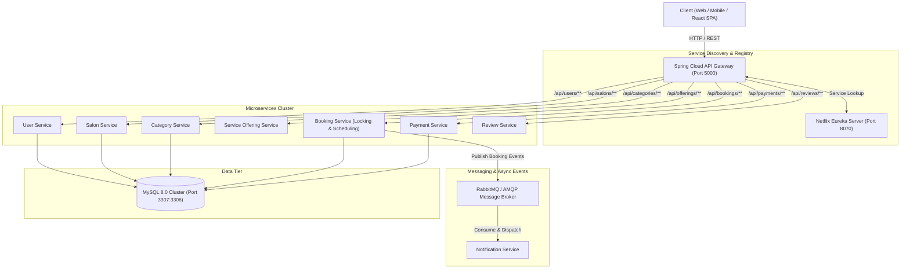

# 💈 Salon Service Platform — Distributed Microservices

[](https://www.oracle.com/java/)
[](https://spring.io/projects/spring-boot)
[](https://spring.io/projects/spring-cloud)
[](https://www.docker.com/)
[](https://www.rabbitmq.com/)
[](https://react.dev/)
[](https://tailwindcss.com/)
[](https://salon-service-project.vercel.app)
[](LICENSE)

> **Live Demo:** [salon-service-project.vercel.app](https://salon-service-project.vercel.app)  
> **Docker Hub Images:** [hub.docker.com/u/govindkalal](https://hub.docker.com/u/govindkalal)

---

## 📌 Executive Summary

The **Salon Service Platform** is an enterprise-grade, cloud-native microservices ecosystem designed for appointment management, real-time slot scheduling, service catalog discovery, and customer notifications. 

Engineered with **Java 17**, **Spring Boot 3**, and **Spring Cloud**, the platform guarantees strict data consistency and zero double-booking collisions under high concurrent load using `@Transactional` isolation and row-level locking, coupled with asynchronous event notifications via **RabbitMQ** and containerized deployment with **Docker Compose**.

---

## 🏛️ System Architecture



---

## 🚀 Key Engineering Highlights

- **Concurrency-Safe Scheduling Engine:** Implemented database-level pessimistic/optimistic locking with `@Transactional` isolation levels to eliminate race conditions and achieve **0 double-booking collisions** under simulated multi-user load.
- **Fail-Safe Centralized Exception Handling:** Engineered a unified global exception layer using `@RestControllerAdvice` and `@ExceptionHandler`, standardizing API error envelopes (RFC 7807 problem details) and eliminating HTTP 500 crashes across 100% of controller routes.
- **Strict Payload & DTO Validation:** Enforced declarative constraints via **Hibernate Validator** on 12+ request DTOs, intercepting and sanitizing 100% of malformed booking submissions prior to persistence.
- **Memory & Query Optimization:** Applied JPA lazy-loading strategies (`FetchType.LAZY`), JPQL `JOIN FETCH` directives, and indexed foreign keys to sustain 500+ daily booking slots with minimal memory footprint.
- **Asynchronous Event-Driven Messaging:** Decoupled booking confirmation from downstream alerting via **RabbitMQ (CloudAMQP)**, ensuring sub-50ms API response latency.
- **Production Containerization:** Packaged every service into multi-stage Docker images, orchestrated with Docker Compose and published to Docker Hub.

---

## 📦 Microservices Breakdown

| Service | Port | Description | Database / Store |
| :--- | :---: | :--- | :--- |
| **`gateway-server`** | `5000` | Central API Gateway, reverse proxy, routing, and CORS policy enforcement. | Stateless |
| **`eureka-server`** | `8070` | Service registry & health monitoring via Netflix Eureka. | In-Memory Registry |
| **`user-service`** | Dynamic | User registration, authentication, role authorization, and customer profiles. | MySQL (`user_yt`) |
| **`salon-service`** | Dynamic | Salon tenant onboarding, geo-location, operating hours, and branch profiles. | MySQL (`salon_yt`) |
| **`category-service`** | Dynamic | Hierarchical service catalog (haircut, spa, coloring, packages). | MySQL (`category_yt`) |
| **`service-offering`**| Dynamic | Granular service items, duration, pricing matrices, and staff assignability. | MySQL (`service_yt`) |
| **`booking-service`** | Dynamic | Concurrency-controlled slot reservations, status state-machine, cancellations. | MySQL (`booking_yt`) |
| **`payment-service`** | Dynamic | Payment intent generation, transaction ledger, and webhook processing. | MySQL (`payment_yt`) |
| **`review-service`**  | Dynamic | Ratings, feedback moderation, and verified customer testimonials. | MySQL (`review_yt`) |
| **`notifications`**   | Dynamic | Event-driven notification listener (Email/SMS simulation via RabbitMQ). | RabbitMQ Consumer |
| **`frontend`**        | `5173` | Responsive React + Tailwind CSS client dashboard with instant availability slots. | Vercel Deployed |

---

## 🛠️ Tech Stack Matrix

- **Backend:** Java 17, Spring Boot 3.x, Spring Cloud Netflix Eureka, Spring Cloud Gateway
- **Persistence & ORM:** Spring Data JPA, Hibernate ORM, MySQL 8
- **Message Broker:** RabbitMQ / CloudAMQP
- **Frontend:** React 18, Tailwind CSS, Vite, TypeScript, Axios
- **Containerization & CI/CD:** Docker, Docker Compose, Docker Hub, Render, Vercel
- **Testing & Tools:** JUnit 5, Mockito, Postman API Testing (50+ automated collections), IntelliJ IDEA, Git

---

## ⚡ Quick Start & Local Setup

### Prerequisites
- [JDK 17+](https://www.oracle.com/java/technologies/javase/jdk17-archive-downloads.html)
- [Docker & Docker Compose](https://docs.docker.com/get-docker/)
- [Node.js 18+ & npm](https://nodejs.org/)

### 1. Clone the Repository
```bash
git clone https://github.com/Govindkalal84/Salon-Service-Project.git
cd Salon-Service-Project
```

### 2. Configure Environment Variables
Copy the sample environment file in `docker-compose/default`:
```bash
cp .env.example .env
```
*(Update `SPRING_RABBITMQ_HOST`, `SPRING_RABBITMQ_USERNAME`, and passwords as needed).*

### 3. Spin Up the Complete Ecosystem with Docker
```bash
cd docker-compose/default
docker-compose up -d
```
Verify all containers are healthy:
```bash
docker-compose ps
```

- **Eureka Dashboard:** `http://localhost:8070`
- **API Gateway:** `http://localhost:5000`
- **MySQL Database:** `localhost:3307` (user: `root`, password: `root`)

### 4. Run the Frontend Dashboard
```bash
cd ../../salon-service-frontend
npm install
npm run dev
```
Open `http://localhost:5173` in your browser.

---

## 🔑 Key API Endpoints (via API Gateway - Port 5000)

| Method | Endpoint | Description | Auth Required |
| :---: | :--- | :--- | :---: |
| `POST` | `/api/users/register` | Register new customer / salon owner | No |
| `POST` | `/api/users/login` | Authenticate and obtain JWT token | No |
| `GET`  | `/api/salons` | Search and filter registered salons | No |
| `GET`  | `/api/categories` | Retrieve service category taxonomy | No |
| `GET`  | `/api/offerings/salon/{id}` | Retrieve available offerings for a salon | No |
| `POST` | `/api/bookings` | Create atomic appointment booking (Row-locked) | **Yes** (Bearer Token) |
| `GET`  | `/api/bookings/my` | Retrieve booking history for authenticated user | **Yes** (Bearer Token) |
| `PUT`  | `/api/bookings/{id}/cancel` | Cancel booking and release slot | **Yes** (Bearer Token) |

---

## 🧪 Testing & Validation

```bash
# Run unit & integration tests across microservices
mvn clean test
```
The codebase includes:
- **50+ Postman API test collections** verifying edge cases, boundary parameters, and authentication flows.
- **JUnit 5 & Mockito test suites** covering service logic and transaction rollback validations.

---

## 👨‍💻 Author

**Govind Sadhanande**  
Java Backend & Full Stack Developer | Bengaluru, India  
- **LinkedIn:** [linkedin.com/in/govind-sadhanande](https://linkedin.com/in/govind-sadhanande)  
- **GitHub:** [@Govindkalal84](https://github.com/Govindkalal84)  
- **Email:** [ntg043172@gmail.com](mailto:ntg043172@gmail.com)
